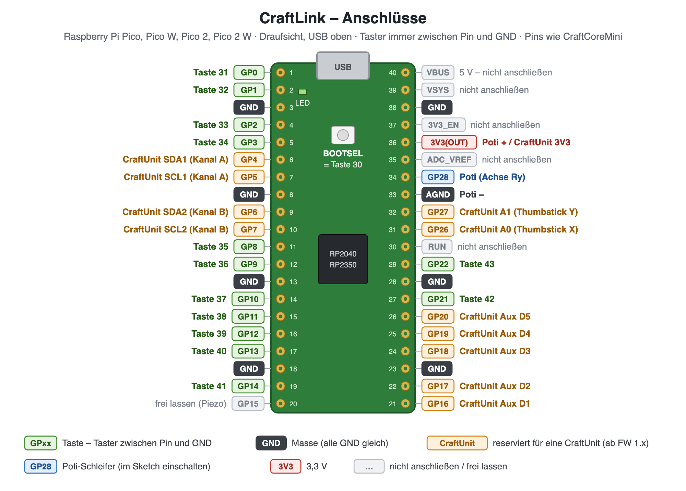
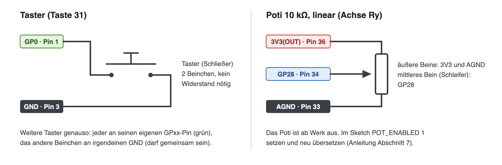

# CraftLink – Anleitung

> **Stand 25.10.2026, Firmware 1.1.** Auf einem Pico getestet (25.10.2026). Gebaut und übersetzt für Raspberry Pi Pico, Pico W, Pico 2 und Pico 2 W (Arduino-Pico 5.6.0). Der CraftUnit-Anschluss ist nur vorbereitet. Neu in 1.1: alle übrigen Tasten einer vollen Tastatur (Feststell, Num-Lock, Num-Enter, Windows, Menü, F13–F24).

## Wozu ist das gut?

ControlHub schickt Tastendrücke und Gamepad-Eingaben nicht selbst ins Spiel. Das macht ein kleines USB-Gerät, das sich am PC als **Gamepad und Tastatur** meldet. Bei der CraftConsole steckt dieses Gerät in der Armlehne.

Der **CraftLink** ist ein Raspberry Pi Pico mit dieser Firmware. Es gibt ihn in drei Ausbaustufen:

1. **Ohne alles** (früher „ControlHub-Dummy“): die Überbrückung für alle ohne CraftConsole. Damit funktioniert alles, was ControlHub ins Spiel schickt:
    - Tasten der Kacheln auf dem Tablet,
    - Makros,
    - GPS-Auslöser am Vorgewende,
    - Tastenleiste an der Karte.
2. **Mit eigenen Tastern und einem Poti:** ein kleiner Selbstbau-Controller (Abschnitt 6).
3. **Mit einer CraftUnit** (Unterbau + Griff aus der Armlehne): die Unit allein am PC nutzen. *Kommt später.* Dafür braucht es eine Platine mit Steckern und I²C-Widerständen (CraftLink-Platine, Pinbelegung wie die CraftCoreMini). An einen nackten Pico lässt sich eine CraftUnit nicht direkt anschließen.

## 1. Was du brauchst

- Raspberry Pi Pico, Pico W, Pico 2 oder Pico 2 W
- ein USB-Kabel, das **Daten** überträgt (manche billigen Kabel können nur laden)
- ControlHub auf dem PC: <https://github.com/HendrikKleinwaechter/ControlHub>

## 2. Firmware aufspielen (ohne Programmieren)

1. Die passende Datei wählen, aus dem Ordner `fertig/` oder unter [Releases](https://github.com/HendrikKleinwaechter/CraftLink-Firmware/releases/latest):

   | Board | Datei |
   |---|---|
   | Raspberry Pi Pico | `CraftLink_1.1_Pico.uf2` |
   | Raspberry Pi Pico W | `CraftLink_1.1_PicoW.uf2` |
   | Raspberry Pi Pico 2 | `CraftLink_1.1_Pico2.uf2` |
   | Raspberry Pi Pico 2 W | `CraftLink_1.1_Pico2W.uf2` |

2. Am Pico die weiße Taste **BOOTSEL** gedrückt halten und dabei das USB-Kabel am PC einstecken. Danach loslassen.
3. Am PC erscheint ein Laufwerk **RPI-RP2** (beim Pico 2: **RP2350**).
4. Die `.uf2`-Datei auf dieses Laufwerk ziehen. Der Pico startet von selbst neu, das Laufwerk verschwindet.
5. Die grüne LED auf dem Pico **blinkt langsam**: Die Firmware läuft und wartet auf ControlHub.

## 3. Mit ControlHub verbinden

1. ControlHub starten (`start-server.bat`).
2. **☰ Menü → Einstellungen → Verbindung → „Armlehne automatisch erkennen“** und dem Assistenten folgen (Pico ab- und wieder anstecken). Der Knopf heißt noch so, gilt aber für jeden Controller.
3. Ist ControlHub verbunden, **leuchtet die LED dauerhaft**. Beim nächsten Start verbindet sich ControlHub von selbst wieder.

| LED | Bedeutung |
|---|---|
| blinkt langsam | Firmware läuft, ControlHub ist nicht verbunden |
| leuchtet dauerhaft | ControlHub ist verbunden |
| flackert kurz | ControlHub gibt einen Signalton aus (z. B. GPS am Vorgewende) |
| aus | kein Strom oder keine Firmware |

## 4. Ausprobieren

- **LED:** Leuchtet sie dauerhaft, sind Pico und ControlHub verbunden.
- **Gamepad:** Unter Windows `Win + R` → `joy.cpl` → **CraftLink** → Eigenschaften. Die **BOOTSEL-Taste** ist im Betrieb **Taste 30**: Drückst du sie, leuchtet dort die 30. Mit ControlHub kommt das nur an, wenn Taste 30 im aktiven Profil belegt ist. Das Standardprofil gibt alle Tasten 1:1 weiter.
- **Kachel-Taste:** Eine Taste auf dem Tablet mit einer Tastatur-Funktion belegen, z. B. „Leertaste“, und in einem Texteditor am PC antippen. Es erscheint ein Leerzeichen.
- Für Fehlersuche gibt es **Einstellungen → Für Entwickler → Live-Diagnose**. Sie zeigt, welche Taste ankommt und was rausgeht. Der Bereich fragt nach dem Code **1164**; er schützt nur vor versehentlichem Herumdrücken.

## 5. Im Spiel

Der Pico meldet sich als Gamepad **„CraftLink“** mit 128 Tasten und 8 Achsen und zusätzlich als **Tastatur**.

- **Tastatur-Funktionen** (z. B. „Alt + 1“) wirken im Spiel sofort.
- **Gamepad-Funktionen** muss das Spiel einmal kennen: in den Steuerungs-Einstellungen des Spiels die gewünschte Aktion auf eine Taste von „CraftLink“ legen. Dabei löst du die Taste über ControlHub aus, z. B. über eine Kachel-Taste mit dieser Gamepad-Taste.

Ohne laufendes ControlHub ist der Pico ein schlichtes Gamepad: Angeschlossene Taster gehen 1:1 als Gamepad-Tasten raus, die Tastatur bleibt stumm.

## 6. Selbst bauen: eigene Taster und ein Poti

Taster und ein Poti lassen sich direkt an den Pico anschließen. Es braucht keine weiteren Bauteile, der Pico hat eingebaute Pull-up-Widerstände.

**Die orange markierten Pins sind für eine CraftUnit reserviert. Dort bitte nichts anschließen.** Die Pinbelegung ist dieselbe wie bei der CraftCoreMini-Platine; GP15 bleibt frei, weil dort auf dieser Platine der Piezo sitzt.

**Taster:** zwischen einen Pin und **GND**.

| Pin | Taste | | Pin | Taste |
|---|---|---|---|---|
| GP0 | 31 | | GP11 | 38 |
| GP1 | 32 | | GP12 | 39 |
| GP2 | 33 | | GP13 | 40 |
| GP3 | 34 | | GP14 | 41 |
| GP8 | 35 | | GP21 | 42 |
| GP9 | 36 | | GP22 | 43 |
| GP10 | 37 | | BOOTSEL | 30 |

Die Tasten 1–29 sind für die CraftUnit vorgesehen, genau wie CraftSlot 1 der CraftConsole. ControlHub erkennt den CraftLink und zeigt in der Tastenbelegung das Modul **„Tasten“** (30–43) als Raster; eine eingeschaltete CraftUnit (Einstellungen → Controller → Module) erscheint zusätzlich wie ein CraftSlot.

**Poti (Achse):** Die äußeren Beine kommen an **3V3 (OUT)** und **AGND**, der Schleifer (Mitte) an **GP28**. Es erscheint als Gamepad-Achse Ry. Das Poti ist ab Werk aus, weil ein offener Analog-Eingang „rauscht“. Zum Einschalten im Sketch `POT_ENABLED 1` setzen und die Firmware selbst übersetzen (Abschnitt 7).

> ⚠️ Niemals 5 V oder VBUS an einen GPIO legen, nur 3V3. GP23–GP25 und GP29 benutzt der Pico selbst, dort nichts anschließen.

## 7. Firmware selbst übersetzen (Arduino IDE)

1. Arduino IDE 2 installieren.
2. **Datei → Einstellungen → Zusätzliche Boardverwalter-URLs:** `https://github.com/earlephilhower/arduino-pico/releases/download/global/package_rp2040_index.json`
3. **Boardverwalter:** „Raspberry Pi Pico/RP2040/RP2350“ von Earle F. Philhower installieren (getestet mit 5.6.0).
4. `CraftLink/CraftLink.ino` öffnen.
5. **Werkzeuge → Board:** „Raspberry Pi Pico“ (bzw. W / 2 / 2 W).
6. **Werkzeuge → USB Stack: „Adafruit TinyUSB“** ← wichtig, sonst gibt es kein Gamepad.
7. Hochladen (beim ersten Mal den Pico mit gedrückter BOOTSEL-Taste einstecken).

Oben im Sketch lässt sich einstellen:

- welche Pins Taster sind (`BUTTON_PINS`, ab Taste `BUTTON_FIRST`),
- ob BOOTSEL als Taste zählt (`BOOTSEL_BUTTON`),
- ob das Poti an GP28 gelesen wird (`POT_ENABLED`),
- ob der Signalton auch als Ton an GP15 kommt (`PIEZO_ENABLED`, nur mit Piezo, z. B. auf der CraftCoreMini),
- der Name des Geräts (`DEVICE_ID`). Wer eine eigene Abwandlung baut, gibt ihr einen eigenen Namen, z. B. `eigen-schaltpult`. Später kann ControlHub daran das passende Geräteprofil wählen.

## 8. Technisches

- **Protokoll:** genau wie die CraftConsole ([CraftConsole-Firmware](https://github.com/HendrikKleinwaechter/CraftConsole-Firmware)).
    - `<FRAME>` mit 128 Tasten und 16 Achsen, höchstens 50 pro Sekunde.
    - Zurück kommt `<OUT>`. Ab 3 gültigen `<OUT>` in Folge gilt ControlHub als verbunden; nach 200 ms ohne `<OUT>` arbeitet der Pico allein.
- **USB:**
    - Kennung 2E8A:CC02; die CraftConsole hat CC01.
    - Hersteller „ControlCraft“, Gerät „CraftLink“.
    - Der Pico erscheint als serieller Anschluss, als Gamepad mit 128 Tasten und 8 Achsen und als Boot-Tastatur.
- **Zeilenbefehle:**
    - `PING`, `VER`, `GETALL` (mit `device=craftlink`, `buttons=14`, `axes=0`, `unit=none`), `STATUS`, `DIAG`, `LEARN ON|OFF`, `MON`, `BEEP <ms>`.
    - `SET` und `CAL` antworten mit `ERR`. Einstellungen und Kalibrierung kommen mit der CraftUnit.
- **CraftUnit-Anschluss** (wie CraftCoreMini J5/J4):
    - Core 8P: 3V3 · SDA1 (GP4) · SCL1 (GP5) · GND · SDA2 (GP6) · SCL2 (GP7) · A0 (GP26) · A1 (GP27).
    - Aux 5P: D1–D5 an GP16–GP20.
- **Tastennamen (`K:`):** wie CraftConsole (ab Firmware 2.13): dazu `KPDOT` (Komma am Ziffernblock), `KPENTER`, `NUMLOCK`, `CAPSLOCK`, `LGUI`/`RGUI` (Windows-Tasten), `MENU` und `F13`–`F24` (seit 1.1).
- **Watchdog:** Hängt die Schleife länger als 4 s, startet der Pico neu.

## 9. Grenzen (Stand 1.1)

- **CraftUnit:** Der Anschluss ist reserviert, wird aber noch nicht ausgelesen.
- **In ControlHub** (Geräteprofile, seit 23.10.2026): Der CraftLink hat eigene Profile, die Tastenbelegung zeigt das Modul „Tasten“. Kalibrierung und Geräte-Einstellungen gibt es nur für die CraftConsole; beim CraftLink blendet ControlHub sie aus.
- **Eigene Abwandlung** (andere `DEVICE_ID`): in ControlHub unter Für Entwickler → Eigene Controller einrichten (Module, Namen, Bild).
- **Achsen:** Es gibt nur die 8 Achsen des ersten Gamepads. Die Achsen 9–16 (zweites Gerät der CraftConsole) gibt es nicht.

## Lizenz

**Open Source** (MIT-Lizenz, `LICENSE`): Firmware, Anleitung und Bilder darfst du nutzen, ändern, weitergeben und auch verkaufen; der Copyright- und Lizenzhinweis muss dabei bleiben. Die fertigen `.uf2`-Dateien enthalten Teile von arduino-pico (LGPL 2.1), Pico SDK (BSD), TinyUSB (MIT) und bei Pico W / Pico 2 W cyw43-driver: Hinweise und Quellcode-Angebot in `THIRD-PARTY-LICENSES.md`, Lizenztexte in `LICENSES/`. Namen und Logo: `NOTICE`.
